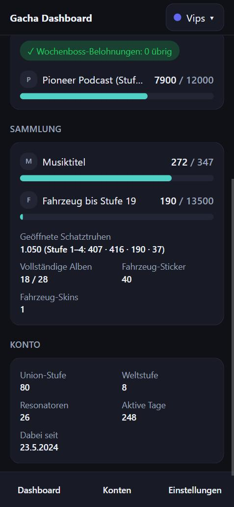
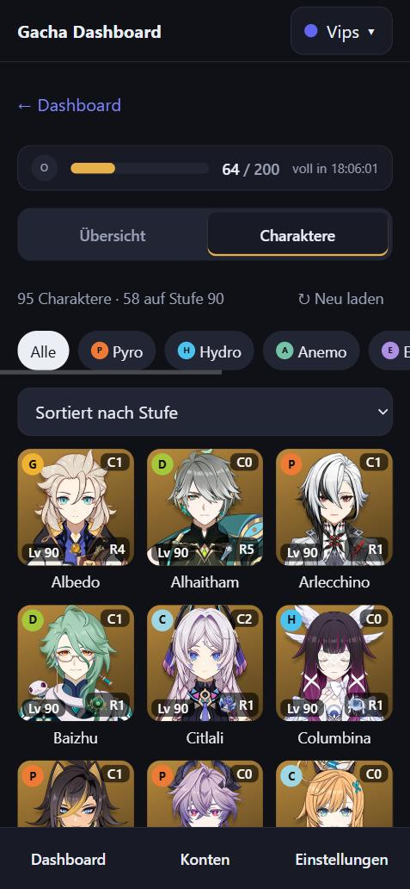
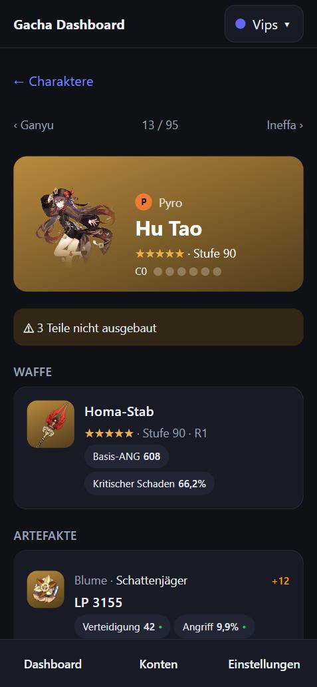
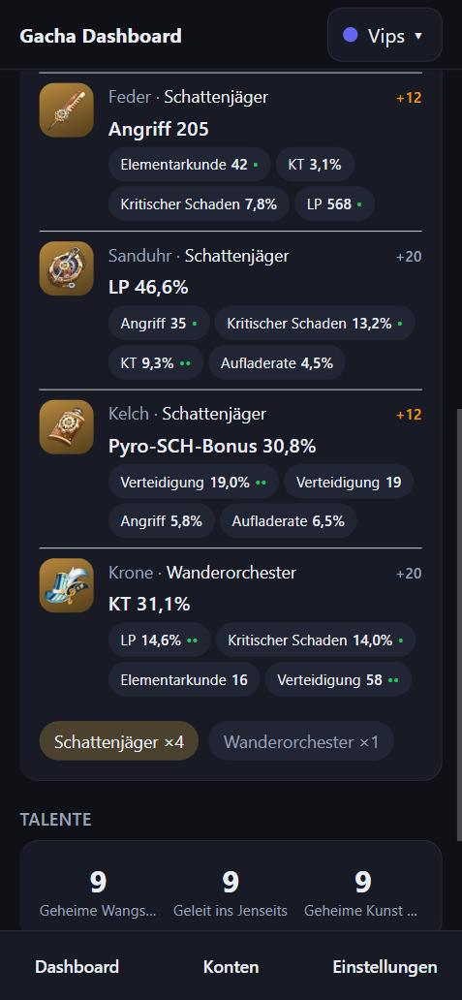
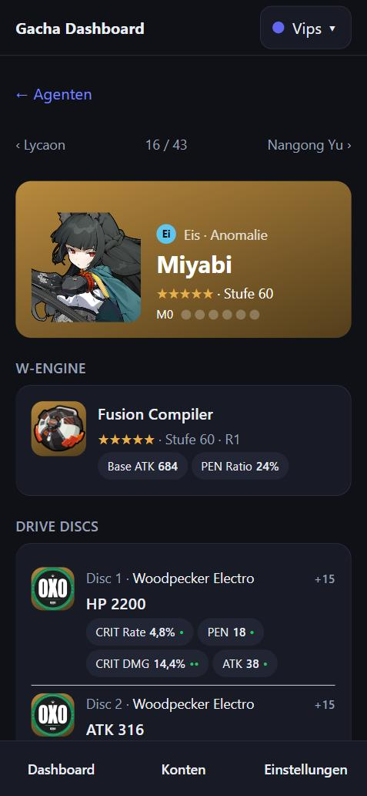

# Konzept: Gacha-Ressourcen-Dashboard (React + TypeScript + Tauri 2)

Oct 29, 2026 · @Hannah

## Ziel und Umfang

Die App zeigt auf einen Blick, wie voll die regenerierenden Ressourcen in jedem Spiel sind und wann sie überlaufen. Sie ist für das Smartphone optimiert, läuft aber auch unter Windows und lokal im Browser aus derselben Codebasis.

In Version 1 enthalten:

- Dashboard mit einer Karte pro Spiel: Stand, Maximum, Zeit bis voll
- Zusatzinfos pro Spiel: Dailies, Expeditionen bzw. Aufträge, Wochenbosse
- Figurenübersicht pro Spiel: Waffe, Ausrüstung, Talente und Werte jeder Figur, siehe "Figurenübersicht"
- Wiederkehrende Herausforderungen pro Spiel wie Spiral Abyss oder Pure Fiction, siehe "Herausforderungen"
- Aktuelle Events und Gacha-Banner pro Spiel, siehe "Events und Banner"
- Manuelles Aktualisieren (Pull-to-Refresh) und automatisches Neuladen im Vordergrund
- Mehrere Profile mit eigenen HoYoLAB-Tokens und Kuro-Code und Wechsel per Tipp

Grundsätze:

- Gespeichert werden nur Anmeldedaten und Profil-Einstellungen. Alle Spieldaten werden zur Laufzeit geladen und nur im Arbeitsspeicher gehalten.
- Rein private App: kein eigener Server, kein Hosting, keine Veröffentlichung im Store. Die App spricht direkt mit den Schnittstellen der Anbieter.

Nicht in Version 1: Gacha-Historie und Pity-Zähler, Push-Benachrichtigungen, automatischer Check-in. Sie sind als spätere Ausbaustufen vorgesehen.

## Datenquellen pro Spiel

Die drei Hoyoverse-Spiele liefern alle Ressourcen live über HoYoLAB. Wuthering Waves liefert sie über die Schnittstelle, die auch die Infokarte im PC-Launcher nutzt.

| Spiel | Hauptressource (Max.) | Weitere Werte | Endpunkt | Authentifizierung |
| --- | --- | --- | --- | --- |
| Genshin Impact | Original Resin (200) | Realm Currency, Expeditionen, Daily Commissions, Wochenboss-Rabatte, Transformer | `bbs-api-os.hoyolab.com/game_record/genshin/api/dailyNote` | HoYoLAB-Cookie + DS-Header |
| Honkai: Star Rail | Trailblaze Power (300), Reserve (2400) | Daily Training, Echo of War, Assignments | `bbs-api-os.hoyolab.com/game_record/hkrpg/api/note` | HoYoLAB-Cookie + DS-Header |
| Zenless Zone Zero | Battery Charge (240) | Engagement, Scratch Card, Video Store | `sg-act-nap-api.hoyolab.com/event/game_record_zzz/api/zzz/note` | HoYoLAB-Cookie + DS-Header |
| Wuthering Waves | Waveplates (240), Waveplate Crystal (480) | Tagesaktivität, Wochenboss, Pioneer Podcast | `pc-launcher-sdk-api.kurogame.net/game/queryRole` | Kuro-`oauthCode` im Body |

Vorgeschaltet ist ein Aufruf von `api-account-os.hoyolab.com/account/binding/api/getUserGameRolesByCookie`. Er liefert für das angemeldete HoYoLAB-Konto alle verknüpften Spielkonten mit UID und Server. Die App zeigt danach automatisch nur die Spiele an, die der Nutzer tatsächlich spielt.

Alle Endpunkte sind inoffiziell. Maximalwerte und Endpunkte stammen aus dem Stand der Community-Tools (Referenz: genshin.py, Starward) und müssen vor der Umsetzung geprüft werden.

**Wuthering Waves:** Der PC-Launcher (ab Version 3.0) zeigt eine Infokarte mit Live-Werten des Kontos. Seine Weboberfläche ruft dafür zwei Endpunkte auf, die die App genauso nutzt:

| Schritt | Aufruf | Body | Ergebnis |
| --- | --- | --- | --- |
| 1 | `POST pc-launcher-sdk-api.kurogame.net/game/queryPlayerInfo?_t=<unix>` | `{ oauthCode }` | `data` mit dem Server als Schlüssel, z. B. `"Europe"`, darin die Spieler-ID |
| 2 | `POST pc-launcher-sdk-api.kurogame.net/game/queryRole?_t=<unix>` | `{ oauthCode, playerId, region }` | `data.<region>` ist ein JSON-String mit `Base`, `BattlePass` und weiteren Blöcken |

Mögliche Server sind `America`, `Asia`, `Europe`, `HMT` und `SEA`. Schritt 1 läuft nur beim Anlegen des Profils, danach stehen Spieler-ID und Server im Profil. Der Wert von `data.<region>` muss ein zweites Mal geparst werden.

Belegt ist der Ablauf durch die Logs des Launchers 3.0.1.0 und zwei Community-Quellen ([Feldbeschreibung](https://blog.3irun.moe/2025/11/10/wuwa_api_document/), [Haiyu #69](https://github.com/HaiyuGame/Haiyu/issues/69)). Die Schnittstelle ist inoffiziell und kann sich mit jedem Launcher-Update ändern.

**Verfügbare Daten der Kuro-Schnittstelle** (ausgelesen am 1. November 2026 mit einem echten Konto):

| Aufruf | Block | Felder | Genutzt |
| --- | --- | --- | --- |
| `queryPlayerInfo` | `data.<region>` | `roleId`, `roleName`, `level`, `sex`, `headPhoto` | Spieler-ID beim Anlegen des Profils |
| `queryRole` | `Base` | `Name`, `Id`, `Level` (Union-Stufe), `WorldLevel`, `CreatTime`, `ActiveDays`, `RoleNum`, `ChapterId`, `SoundBox`, `BirthMon`, `BirthDay`, `serverTimezone` | Name im Kopf, Abschnitt Konto: Union-Stufe, Weltstufe, Resonatoren, aktive Tage, Dabei seit |
| `queryRole` | `Base` | `Energy`, `MaxEnergy`, `EnergyRecoverTime`, `StoreEnergy`, `MaxStoreEnergy`, `StoreEnergyRecoverTime` | Waveplates und Crystal |
| `queryRole` | `Base` | `Liveness`, `LivenessMaxCount`, `LivenessUnlock`, `WeeklyInstCount` | Tagesaktivität, Wochenboss |
| `queryRole` | `Base` | `Boxes`, `BasicBoxes`, `PhantomBoxes` jeweils als Zählung pro Stufe | `Boxes` als geöffnete Schatztruhen. `BasicBoxes` und `PhantomBoxes` sind nicht eindeutig belegt und werden nicht angezeigt |
| `queryRole` | `BattlePass` | `Level`, `Exp`, `ExpLimit`, `WeekExp`, `WeekMaxExp`, `IsUnlock`, `IsOpen` | Pioneer Podcast mit Wochen-EXP. `Exp` und `ExpLimit` nicht, weil ihre Bedeutung auf der Höchststufe 70 unklar ist |
| `queryRole` | `MotorData` | `Level`, `Exp`, `NextExp`, `Skins[]`, `Stickers[]`, `Decorations[]`, `Frames[]`, `EquipSkin` mit `Id` und `Quality` | Abschnitt Sammlung: Fahrzeug-Stufe mit EXP, Anzahl Sticker und Skins |
| `queryRole` | `MusicData` | `Albums[]` mit `Id`, `Count`, `TotalCount` | Abschnitt Sammlung: Musiktitel gesamt und vollständige Alben |
| `queryRole` | `DecorationData` | `Datas[]` mit `Id`, `Quality`, `SkinOwner[]`, `OrGroupId` | Nein, nur IDs ohne Namen |

Figuren, Waffen, Echos und Resonanzketten liefert die Schnittstelle nicht. Für Figuren gibt es nur die Anzahl `Base.RoleNum`. Naheliegende weitere Endpunkte wie `queryRoleList`, `queryRoleDetail` oder `queryRoleInfo` antworten mit HTTP 404. Die Figurenübersicht zeigt für Wuthering Waves deshalb nur die Anzahl der Resonatoren.

## Architektur

Oberfläche und API-Logik sind für alle Plattformen identisch. Nur die HTTP-Schicht entscheidet, ob ein Aufruf über Tauri oder über den lokalen Proxy läuft.

&#91;embedded content: Architektur · 4 Schichten, 2 Betriebsarten\]

In der App nutzt die API-Schicht das HTTP-Plugin von Tauri, im Browser den lokalen Proxy. Die Tauri-Plugins sind `plugin-http` für die Aufrufe und tauri-plugin-secure-keystore für die Tokens. Ein allgemeiner Dateizugriff ist für Version 1 nicht nötig. Nur unter Windows liest ein eigener Rust-Befehl den Kuro-Code aus der Cache-Datei des Launchers, siehe "Anmeldung und Sicherheit".

## Datenmodell

Jedes Spiel wird über einen Adapter auf denselben Typ abgebildet. Die Oberfläche kennt nur diesen Typ und muss für ein neues Spiel nicht angepasst werden.

```typescript
type GameId = "genshin" | "starrail" | "zzz" | "wuwa";

interface Resource {
  label: string;          // "Original Resin"
  current: number;
  max: number;
  fullAt?: Date;          // aus der Restzeit berechnet
}

interface Task {
  label: string;          // "Daily Commissions"
  done: number;
  total: number;
}

interface GameStatus {
  game: GameId;
  uid: string;
  nickname: string;
  primary: Resource;      // die große Anzeige auf der Karte
  secondary: Resource[];  // Reserve, Realm Currency usw.
  tasks: Task[];
  fetchedAt: Date;
}

interface GameAdapter {
  game: GameId;
  fetchStatus(account: Account): Promise<GameStatus>;
}
```

Die Schnittstellen liefern die Restzeit bis voll in Sekunden. Der Adapter rechnet sie beim Laden in einen festen Zeitpunkt `fullAt` um. Daraus berechnet die Oberfläche den aktuellen Stand lokal weiter, ohne erneut anzufragen (z. B. +1 Resin alle 8 Minuten).

## UI-Konzept für das Smartphone

Das Dashboard ist ein einspaltiger Kartenstapel im Hochformat. Alle wichtigen Aktionen liegen im unteren Bildschirmdrittel und sind mit dem Daumen erreichbar.

&#91;embedded content: Dashboard-Skizze · Smartphone, Hochformat\]

| Screen | Inhalt |
| --- | --- |
| Dashboard | Eine Karte pro Spielkonto: Hauptressource mit Balken, Zeit bis voll, wichtigste Daily-Aufgabe |
| Spieldetail | Tab "Übersicht" mit allen Live-Werten des Spiels in den Abschnitten Täglich, Wöchentlich, Laufend und Weitere, siehe "Detailseite pro Spiel", dazu Events und Banner, siehe "Events und Banner". Tab "Figuren" mit dem Raster aller Figuren, siehe "Figurenübersicht". Tab "Herausforderungen" mit den Endgame-Modi, siehe "Herausforderungen" |
| Figur-Detail | Waffe, Ausrüstung, Sets, Talente und Werte einer Figur, Blättern zur nächsten Figur |
| Konten | Profile anlegen, bearbeiten und löschen; pro Profil Token-Eingabe, Spiele ein- und ausblenden |
| Einstellungen | Aktualisierungsintervall, helles oder dunkles Design, Sprache |

Gestaltungsregeln:

- Mobile-first mit Tailwind: Basis-Layout für 360 px Breite, ab `md` zwei Spalten für Windows und Browser
- Tippflächen mindestens 44 × 44 px
- Abstände zu Notch und Gestenleiste über `env(safe-area-inset-*)`
- Helles und dunkles Design nach Systemeinstellung
- Jedes Spiel erhält eine eigene Akzentfarbe am Kartenrand, damit die Karten auf einen Blick unterscheidbar sind

## Detailseite pro Spiel

Ein Tipp auf eine Karte öffnet die Detailseite des Spiels. Sie zeigt alle Live-Werte, die der Notizen-Endpunkt liefert, gruppiert nach Täglich, Wöchentlich und Laufend. Es ist kein zusätzlicher Aufruf nötig: Dashboard und Detailseite nutzen dieselbe Antwort, die Detailseite lädt beim Öffnen nur neu.

Aufbau von oben nach unten:

1. **Kopf:** Hauptressource groß mit Balken, Zeit bis voll als Uhrzeit und Countdown
2. **Täglich:** Aufgaben mit Fortschritt und Haken, sobald erledigt
3. **Wöchentlich:** Rabatte und Wochenpunkte mit verbleibender Anzahl
4. **Laufend:** Expeditionen bzw. Aufträge mit eigenem Countdown, nach Restzeit sortiert, fertige oben mit "Fertig"
5. **Weitere Ressourcen:** Nebenwährungen und Abklingzeiten
6. **Sammlung:** Fortschritt bei Sammelobjekten mit Balken und Kennwerten, derzeit nur Wuthering Waves
7. **Konto:** Feste Kennwerte wie Kontostufe und aktive Tage ohne Balken, derzeit nur Wuthering Waves

Alle Restzeiten werden beim Laden in feste Zeitpunkte umgerechnet und lokal im Sekundentakt heruntergezählt, wie auf dem Dashboard. Ein Abschnitt ohne Daten wird ausgeblendet, z. B. wenn ein Spielmodus noch nicht freigeschaltet ist.

**Genshin Impact** ([Feldreferenz](https://seria.is-a.dev/genshin.py/reference/models/genshin/chronicle/notes/))

| Bereich | Anzeige | API-Feld | Darstellung |
| --- | --- | --- | --- |
| Kopf | Original Resin | `current_resin`, `max_resin`, `resin_recovery_time` | Balken, "voll um" und Countdown |
| Täglich | Daily Commissions | `finished_task_num`, `total_task_num` | 3/4, Haken bei 4/4 |
| Täglich | Commission-Belohnung abgeholt | `is_extra_task_reward_received` | Ja/Nein |
| Täglich | Gespeicherte Begegnungspunkte | `daily_task.stored_attendance` | Zahl |
| Wöchentlich | Wochenboss-Rabatte | `remain_resin_discount_num`, `resin_discount_num_limit` | "2 von 3 übrig" |
| Laufend | Expeditionen | `expeditions[]` mit `remained_time`, `avatar_side_icon` | Liste mit Figurenbild und Countdown |
| Weitere | Realm Currency | `current_home_coin`, `max_home_coin`, `home_coin_recovery_time` | Balken, "voll in" |
| Weitere | Parametrischer Transformator | `transformer.recovery_time` | "Bereit" oder "bereit in 3 T 4 h" |

**Honkai: Star Rail** ([Feldreferenz](https://seria.is-a.dev/genshin.py/reference/models/starrail/chronicle/notes/))

| Bereich | Anzeige | API-Feld | Darstellung |
| --- | --- | --- | --- |
| Kopf | Trailblaze Power | `current_stamina`, `max_stamina`, `stamina_recover_time` | Balken, "voll um" und Countdown |
| Kopf | Reserved Trailblaze Power | `current_reserve_stamina`, `is_reserve_stamina_full` | Zahl, Hinweis bei voll |
| Täglich | Daily Training | `current_train_score`, `max_train_score` | 400/500, Haken bei voll |
| Wöchentlich | Echo of War | `remaining_weekly_discounts`, `max_weekly_discounts` | "1 von 3 übrig" |
| Wöchentlich | Simulated Universe | `current_rogue_score`, `max_rogue_score` | Balken |
| Wöchentlich | Divergent Universe, Bonuspunkte | `current_bonus_synchronicity_points`, `max_bonus_synchronicity_points` | Balken, nur wenn `have_bonus_synchronicity_points` |
| Laufend | Assignments | `expeditions[]` mit `name`, `remaining_time`, `avatars` | Liste mit Countdown, Kopf "4/4 vergeben" aus `accepted_expedition_num`, `total_expedition_num` |

**Zenless Zone Zero** ([Feldreferenz](https://thesadru.github.io/genshin.py/pdoc/genshin/models/zzz/chronicle/notes.html))

| Bereich | Anzeige | API-Feld | Darstellung |
| --- | --- | --- | --- |
| Kopf | Battery Charge | `energy.progress`, `energy.restore` | Balken, "voll um" und Countdown |
| Täglich | Engagement | `vitality.current`, `vitality.max` | 300/400, Haken bei voll |
| Täglich | Scratch Card | `card_sign` | Erledigt/Offen |
| Täglich | Video Store | `vhs_sale.sale_state` | Status, z. B. "Umsatz abholbar" |
| Wöchentlich | Bounty Commission | `bounty_commission` | "2 von 4" |
| Wöchentlich | Survey Points | `survey_points` | Balken |

**Wuthering Waves** ([Feldreferenz](https://blog.3irun.moe/2025/11/10/wuwa_api_document/))

| Bereich | Anzeige | API-Feld | Darstellung |
| --- | --- | --- | --- |
| Kopf | Waveplates | `Base.Energy`, `Base.MaxEnergy`, `Base.EnergyRecoverTime` | Balken, "voll um" und Countdown |
| Kopf | Waveplate Crystal | `Base.StoreEnergy`, `Base.MaxStoreEnergy` | Zahl, Hinweis bei voll |
| Täglich | Tagesaktivität | `Base.Liveness`, `Base.LivenessMaxCount` | 80/100, Haken bei voll, nur wenn `Base.LivenessUnlock` |
| Wöchentlich | Wochenboss-Belohnungen | `Base.WeeklyInstCount` | "2 übrig" |
| Wöchentlich | Pioneer Podcast | `BattlePass.WeekExp`, `BattlePass.WeekMaxExp`, `BattlePass.Level` | Balken mit Stufe, nur wenn `BattlePass.IsOpen` |
| Sammlung | Musiktitel | Summe von `MusicData.Albums[].Count` und `TotalCount` | Balken, z. B. 272 / 347 |
| Sammlung | Fahrzeug | `MotorData.Level`, `MotorData.Exp`, `MotorData.NextExp` | Balken "bis Stufe 19" |
| Sammlung | Schatztruhen, vollständige Alben, Sticker, Skins | `Base.Boxes`, `MusicData.Albums`, `MotorData.Stickers`, `MotorData.Skins` | Kennwerte, Truhen mit Aufteilung nach Stufe |
| Konto | Union-Stufe, Weltstufe, Resonatoren, aktive Tage, Dabei seit | `Base.Level`, `Base.WorldLevel`, `Base.RoleNum`, `Base.ActiveDays`, `Base.CreatTime` | Kennwerte ohne Balken |

Anders als bei HoYoLAB liefert `EnergyRecoverTime` keine Restzeit, sondern direkt den Zeitpunkt in Unix-Millisekunden. Der Wert ist 0, wenn die Waveplates schon voll sind. Ein Waveplate lädt alle 6 Minuten, ein Crystal alle 12 Minuten. Laufende Aufträge gibt es in Wuthering Waves nicht, der Abschnitt Laufend entfällt.



*Wuthering Waves in der App: Sammlung mit Musiktiteln, Fahrzeug und Schatztruhen, darunter feste Kennwerte des Kontos.*

Die API-Feldnamen der Hoyoverse-Spiele stammen aus den Rohdaten, die die Community-Bibliothek genshin.py auswertet. Die Feldnamen für Wuthering Waves stammen aus einer echten Antwort im Launcher-Log. Ihre Bedeutung beruht teils auf Annahmen der Community und ist beim Durchstich zu prüfen. Seit Kurzem gibt es in ZZZ eine Backup Battery Charge, ob die API sie liefert, ist beim Durchstich zu prüfen.

Für die Detailseite wird `GameStatus` um Abschnitte erweitert. Die Adapter füllen sie, die Oberfläche rendert sie generisch:

```typescript
interface Countdown {
  label: string;          // "Expedition", Assignment-Name
  readyAt: Date;          // aus der Restzeit berechnet
  iconUrl?: string;       // Figurenbild aus der API
}

interface Flag {
  label: string;          // "Scratch Card"
  done: boolean;
  text?: string;          // z. B. Video-Store-Status
}

interface Fact {
  label: string;          // "Union-Stufe"
  value: string;          // "80"
}

interface DetailSection {
  kind: "daily" | "weekly" | "running" | "other" | "collection" | "account";
  resources: Resource[];
  tasks: Task[];
  flags: Flag[];
  timers: Countdown[];
  facts: Fact[];          // feste Kennwerte ohne Balken
}

interface GameStatus {
  // ... bisherige Felder
  sections: DetailSection[];
}
```

&#91;embedded content: Detailseite-Skizze · Genshin Impact, Smartphone\]

Star Rail, ZZZ und Wuthering Waves folgen demselben Aufbau mit ihren eigenen Feldern aus den Tabellen oben.

## Figurenübersicht

Die Detailseite hat zwei Tabs: **Übersicht** mit den Live-Werten und **Figuren** mit allen Figuren des Kontos. Der Figuren-Tab zeigt auf einen Blick, welche Waffe und welche Ausrüstung jede Figur trägt, und bei Bedarf alle Details dazu. Es gelten dieselben Grundsätze wie bei den Live-Werten: Figurendaten werden zur Laufzeit geladen und nur im Arbeitsspeicher gehalten, Bilder kommen als URL aus der API.

Nicht enthalten sind Schadensrechner, Bewertung der Ausrüstung mit Punktzahl, Vergleich mit Builds aus Guides und Planung von Materialien. Sie bleiben spätere Ausbaustufen.

**Begriffe pro Spiel**

Die Spiele nennen dieselben Konzepte unterschiedlich. Die Oberfläche nutzt die Begriffe des jeweiligen Spiels aus `GAME_TERMS` in `model/games.ts`, das Datenmodell ist für alle gleich.

| Konzept | Genshin Impact | Honkai: Star Rail | Zenless Zone Zero | Wuthering Waves |
| --- | --- | --- | --- | --- |
| Figur | Charakter | Charakter | Agent | Resonator |
| Duplikate | Konstellation C0–C6 | Eidolon E0–E6 | Mindscape M0–M6 | Resonanzkette S0–S6 |
| Waffe | Waffe | Lichtkegel | W-Engine | Waffe |
| Waffen-Duplikate | Veredelung R1–R5 | Überlagerung S1–S5 | Stufe R1–R5 | Syntonisierung R1–R5 |
| Ausrüstung | 5 Artefakte | 4 Relikte + 2 Planar-Ornamente | 6 Drive Discs | 5 Echos |
| Talente | 3 Talente | 4 Fähigkeiten | 6 Fertigkeiten | – |
| Filter neben Element | – | Pfad | Rolle | – |

**Datenquellen**

Die Hoyoverse-Spiele haben eigene Endpunkte der Battle Chronicle mit derselben Authentifizierung wie die Notizen. Wuthering Waves liefert keine Figurendaten, siehe "Verfügbare Daten der Kuro-Schnittstelle".

| Spiel | Liste | Details | Laden der Details |
| --- | --- | --- | --- |
| Genshin Impact | `POST bbs-api-os.hoyolab.com/game_record/genshin/api/character/list` mit `{ role_id, server }` | `POST …/genshin/api/character/detail` mit `{ role_id, server, character_ids }` | Vorladen in Blöcken zu je 10 Figuren |
| Honkai: Star Rail | `GET bbs-api-os.hoyolab.com/game_record/hkrpg/api/avatar/info?server=&role_id=&need_wiki=true` | Gleiche Antwort | Ein Aufruf liefert alles |
| Zenless Zone Zero | `GET sg-act-nap-api.hoyolab.com/event/game_record_zzz/api/zzz/avatar/basic?server=&role_id=` | `GET …/zzz/avatar/info?server=&role_id=&id_list[]=<id>&need_wiki=true` | Beim Antippen, eine Figur pro Aufruf |
| Wuthering Waves | Nur `Base.RoleNum` aus `queryRole` | – | – |

Pfade und Feldnamen stammen aus der Community-Bibliothek genshin.py und sind am 1. November 2026 mit echten Antworten geprüft worden. Dabei hat sich gezeigt:

- **ZZZ:** `avatar/info` nimmt nur eine ID pro Aufruf, bei mehreren meldet es `retcode` -400005 ("Parameter Error"). Seltenheiten kommen als Buchstaben (`S`, `A`, `B`).
- **Erhöhungen der Nebenwerte:** Genshin liefert in `times` nur die Erhöhungen. Star Rail zählt in `times` den Startwert mit, angezeigt wird `times - 1`. ZZZ liefert die Erhöhungen im Feld `add` der Disc-Werte.
- **Sprache:** Genshin und Star Rail liefern mit `x-rpc-language: de-de` deutsche Namen. ZZZ liefert Werte und Set-Namen trotzdem auf Englisch.
- **Star Rail:** Die Antwort enthält keine Set-Namen, nur die Namen der einzelnen Relikte. Set-Boni und der Hinweis "Set unvollständig" entfallen dort.
- **Wertenamen:** Genshin liefert sie in `property_map`, Star Rail in `property_info`, ZZZ direkt im Wert als `property_name`.

| Spiel | Waffe | Ausrüstung | Talente | Werte |
| --- | --- | --- | --- | --- |
| Genshin Impact | `weapon` mit `affix_level`, `main_property`, `sub_property` | `relics[]` mit `pos`, `set.name`, `set.affixes`, `main_property`, `sub_property_list` | `skills[]` mit `skill_type` 1 | `base_properties`, `extra_properties`, `element_properties` |
| Honkai: Star Rail | `equip` mit `rank` | `relics[]` (`pos` 1–4), `ornaments[]` (`pos` 5–6) mit `main_property`, `properties` | `skills[]` mit `point_type` 2, `anchor` Point01–04 | `properties[]`, dazu `servant_detail` für Memosprites |
| Zenless Zone Zero | `weapon` mit `star`, `main_properties`, `properties` | `equip[]` mit `equipment_type` 1–6, `equip_suit` mit `desc1`, `desc2` | `skills[]` mit `skill_type` 0–6 | `properties[]` |

**Datenmodell**

Ein Adapter pro Spiel in `api/characters/` bildet die Antworten auf gemeinsame Typen ab. Werte kommen als fertig formatierter Text aus dem Adapter, weil jedes Spiel Prozente und Ganzzahlen anders liefert.

```typescript
interface Stat {
  key: string;            // property_type-ID oder Name
  label: string;          // "Krit. Rate"
  value: string;          // "62,4%"
  rolls?: number;         // Anzahl der Erhöhungen bei Nebenwerten
}

interface GearPiece {
  slot: number;           // 1-basiert, Platzname aus GAME_TERMS
  name: string;
  setName?: string;
  rarity: number;
  level: number;
  maxLevel: number;       // aus der Seltenheit, z. B. +20 bei 5-Sterne-Artefakten
  mainStat?: Stat;
  subStats: Stat[];
}

interface CharacterSummary {
  id: string;
  name: string;
  element: string;        // "pyro", für Farbe und Filter
  role?: string;          // Pfad (Star Rail), Rolle (ZZZ)
  rarity: number;
  level: number;
  dupes: number;          // 0–6
  iconUrl?: string;
  weapon?: { name: string; iconUrl?: string; rarity: number; refinement: number };
}

interface Character extends CharacterSummary {
  weapon?: Weapon;        // mit Stufe, Haupt- und Nebenwert
  gear: GearPiece[];
  sets: GearSet[];        // Name, angelegte Teile, Boni mit Text
  skills: Skill[];
  stats: Stat[];          // wichtigste Werte
  moreStats: Stat[];      // erst nach "Alle Werte"
  companion?: { name: string; iconUrl?: string };
}

interface CharacterAdapter {
  game: GameId;
  prefetchDetails: boolean;
  fetchRoster(account: Account, signal?: AbortSignal): Promise<Roster>;
  fetchDetails(account: Account, ids: string[], signal?: AbortSignal): Promise<Character[]>;
}
```

**Laden und Aktualisieren**

Figurendaten ändern sich selten und sind deutlich größer als die Notizen. Sie werden deshalb getrennt und sparsam geladen.

- Die Liste wird erst geladen, wenn der Figuren-Tab geöffnet wird. Query-Schlüssel `["roster", profileId, game, uid]`, 30 Minuten frisch, kein Neuladen im Intervall oder bei Fokus.
- Bei Genshin lädt die App danach die Details aller Figuren in Blöcken zu je 10 nach. Bricht ein Block ab, z. B. wegen des Rate-Limits, bleiben die bereits geladenen Details erhalten.
- Bei ZZZ werden Details erst beim Antippen einer Figur geladen (`["character", profileId, game, uid, id]`).
- "Neu laden" über dem Raster lädt Liste und Details neu. Das automatische Neuladen der Notizen berührt die Figurendaten nicht.

**Figurenliste**

```
┌──────────────────────────────────┐
│ ← Dashboard                      │
│ [Resin ▓▓▓▓▓░ 162/200 voll in …] │
│ ┌ Übersicht ┐┌ Charaktere ┐      │
│ 95 Charaktere · 58 auf Stufe 90  │
│ [Alle][Pyro][Hydro][…]           │
│ [Sortiert nach Stufe        ▾]   │
│ ┌──────┐ ┌──────┐ ┌──────┐       │
│ │P   C1│ │H   C0│ │E   C6│       │
│ │ Bild │ │ Bild │ │ Bild │       │
│ │Lv 90⚠│ │Lv 90 │ │Lv 90 │       │
│ │    R1│ │    R1│ │    R5│       │
│ └──────┘ └──────┘ └──────┘       │
│ Hu Tao   Furina   Fischl         │
└──────────────────────────────────┘
```

- Die Hauptressource bleibt im Figuren-Tab als eine Zeile sichtbar. Der Tab steht in der URL (`?tab=figuren`), damit der Zurück-Knopf unter Android wie erwartet funktioniert.
- Raster mit drei Spalten auf dem Smartphone, ab `md` sechs Spalten.
- Jede Kachel: Porträt auf Hintergrund in Seltenheitsfarbe, Element oben links, Duplikate oben rechts, Stufe unten links, Waffe mit Veredelung unten rechts, Name darunter. Ein ⚠ markiert eine Ausrüstungslücke, sobald die Details geladen sind.
- Filter als Chips nach Element, bei Star Rail zusätzlich nach Pfad und bei ZZZ nach Rolle. Sortierung nach Stufe, Seltenheit, Duplikaten oder Name. Filter und Sortierung merkt sich die App pro Spiel im `localStorage`, es sind reine Anzeige-Einstellungen.
- Elemente erscheinen als farbige Plakette mit Anfangsbuchstaben. Neuere ZZZ-Elementtypen wie `300` sind noch nicht zugeordnet und erscheinen ohne Plakette.



*Figuren-Tab in der App (Genshin Impact, dunkles Design, Smartphone-Breite).*

**Figur-Detail**

Ein Tipp auf eine Kachel öffnet die Route `/game/:game/:uid/figur/:id`. Aufbau von oben nach unten:

1. **Kopf:** Bild, Name, Element und Pfad bzw. Rolle, Seltenheit, Stufe, Duplikate als sechs Punkte.
2. **Hinweise:** Ausrüstungslücken, siehe unten.
3. **Waffe:** Symbol, Name, Stufe, Veredelung, Haupt- und Nebenwert.
4. **Ausrüstung:** Eine Zeile pro Platz in Spielreihenfolge mit Set-Name, Stufe, Hauptwert groß und Nebenwerten als Chips. Erhöhungen erscheinen als Punkte am Chip, z. B. "Krit. Schaden 14,0% ••". Leere Plätze erscheinen gestrichelt.
5. **Sets:** Chips mit Set-Name und Teilezahl, ein Tipp zeigt die Bonustexte.
6. **Talente:** Stufen nebeneinander.
7. **Werte:** Die wichtigsten Werte, darunter "Alle Werte" zum Aufklappen.
8. **Memosprite:** Nur bei Star Rail auf dem Pfad der Erinnerung.

Pfeile oben und Wischen nach links oder rechts wechseln zur nächsten Figur in der Reihenfolge des Rasters.

<p>
  
  
  
</p>

*Figur-Detail in der App. Links Kopf, Hinweis und Waffe, in der Mitte Artefakte mit Erhöhungen als Punkte und Set-Chips (beides Genshin Impact), rechts derselbe Aufbau für einen Agenten in Zenless Zone Zero.*

**Hinweise auf Ausrüstungslücken**

Die App prüft nur eindeutige Regeln in `gearHints.ts` und gibt keine Build-Empfehlungen.

| Hinweis | Regel |
| --- | --- |
| Platz leer | Ein Platz aus `GAME_TERMS.slots` ist nicht belegt |
| Set unvollständig | Ein Set mit 3 Teilen, also ein knapp verpasster 4er-Bonus. Ein einzelnes Teil gilt nicht als Lücke, weil 4+1-Kombinationen üblich sind |
| Teile nicht ausgebaut | Teil unter Maximalstufe, z. B. Artefakt unter +20 |
| Waffe unter Figurenstufe | Waffenstufe kleiner als Figurenstufe, oder keine Waffe angelegt |

## Herausforderungen

Die Detailseite hat einen dritten Tab **Herausforderungen**. Er zeigt die wiederkehrenden Endgame-Modi des Spiels, z. B. Spiral Abyss in Genshin oder Pure Fiction in Star Rail. Pro Modus gibt es eine Karte mit dem Stand der laufenden Periode und ihrer Restlaufzeit. Ein Umschalter auf der Karte wechselt zur vorherigen Periode.

**Modi und Endpunkte**

Alle Endpunkte gehören zur Battle Chronicle und nutzen dieselbe Authentifizierung wie die Notizen. Pfade und Feldnamen stammen aus der Community-Bibliothek genshin.py und sind beim Durchstich mit echten Antworten zu prüfen.

| Spiel | Modus | Endpunkt | Anzeige |
| --- | --- | --- | --- |
| Genshin Impact | Spiral Abyss | `GET …/genshin/api/spiralAbyss?server=&role_id=&schedule_type=` | Sterne von 36, tiefste Kammer, gewonnene Kämpfe, Sterne der Etagen 9–12 |
| Genshin Impact | Imaginarium Theater | `GET …/genshin/api/role_combat?server=&role_id=&need_detail=false` | Erreichter Akt, Schwierigkeit, Medaillen, Fantasia-Blumen |
| Genshin Impact | Stygian Onslaught | `GET …/genshin/api/hard_challenge?server=&role_id=&need_detail=false` | Beste Stufe und Zeit, allein und im Koop |
| Honkai: Star Rail | Memory of Chaos | `GET …/hkrpg/api/challenge?server=&role_id=&schedule_type=&need_all=true` | Sterne von 36, höchste Stufe, Kämpfe, Zusatzsterne |
| Honkai: Star Rail | Pure Fiction | `GET …/hkrpg/api/challenge_story?…` | Sterne von 12, höchste Stufe, Kämpfe |
| Honkai: Star Rail | Apocalyptic Shadow | `GET …/hkrpg/api/challenge_boss?…` | Sterne von 12, höchste Stufe, Kämpfe |
| Honkai: Star Rail | Anomaly Arbitration | `GET …/hkrpg/api/challenge_peak?server=&role_id=&schedule_type=3` | Boss, Sterne für Boss und Gegner, Kämpfe |
| Zenless Zone Zero | Shiyu Defense | `GET …/zzz/hadal_info_v2?server=&role_id=&schedule_type=` | Punkte von der Höchstpunktzahl, Bewertung, Rangliste, fünfte Front. Bei `hadal_ver` v1 höchste Stufe und Bewertungen |
| Zenless Zone Zero | Deadly Assault | `GET …/zzz/hadal_mem_detail_v2?uid=&region=&schedule_type=` | Sterne von 9, Punkte, Rangliste |
| Zenless Zone Zero | Threshold Simulation | `GET …/zzz/void_front_battle_period_abstract_info?uid=&region=&schedule_type=` | Punkte, Rangliste, erreichtes Ende. Die Antwort enthält keine Laufzeit |
| Wuthering Waves | – | – | Die Kuro-Schnittstelle liefert nichts zu Tower of Adversity oder Whimpering Wastes. Der Tab wird ausgeblendet |

`schedule_type` ist 1 für die laufende und 2 für die vorherige Periode. Imaginarium Theater, Stygian Onslaught und Anomaly Arbitration kennen diesen Parameter nicht oder anders. Ihre Antwort enthält mehrere Perioden als Liste, die neueste zuerst. Bei Stygian Onslaught werden wie in genshin.py Einträge mit `is_valid: false` übergangen.

**Zeiten**

Genshin liefert Beginn und Ende als Unix-Sekunden. Star Rail und ZZZ liefern Datumsteile (`year`, `month`, `day`, `hour`, `minute`) in Serverzeit. Die App rechnet sie mit der festen Abweichung des Servers um: Amerika UTC−5, Europa UTC+1, Asien und TW/HK/MO UTC+8. Die Server kennen keine Sommerzeit. Die Region kommt aus dem Konto, z. B. `os_euro`, `prod_official_eur` oder `prod_gf_eu`.

**Höchstwerte**

Die Antworten enthalten die Höchstzahl der Sterne nicht, sie ist deshalb fest hinterlegt: Spiral Abyss und Memory of Chaos 36, Pure Fiction und Apocalyptic Shadow 12, Deadly Assault 9. Die Aktzahl im Imaginarium Theater hängt von der Schwierigkeit ab: Leicht 3, Normal 6, Schwer 8, Visionär und Arkana 10. Ändert ein Spiel-Update diese Werte, müssen sie in `api/challenges/` angepasst werden.

**Darstellung**

```
┌──────────────────────────────────┐
│ ┌Übersicht┐┌Charaktere┐┌Herausf.┐ │
│ 3 Modi                ↻ Neu laden │
│ ┌──────────────────────────────┐ │
│ │ Spiral Abyss [Aktuell|Vorh.] │ │
│ │ läuft bis 07.11. · noch 6 T  │ │
│ │ Sterne                 33/36 │ │
│ │ ▓▓▓▓▓▓▓▓▓▓▓▓▓▓▓▓▓▓▓▓▓▓▓░░░   │ │
│ │ Tiefste Kammer  Kämpfe gew.  │ │
│ │ 12-3            12 von 14    │ │
│ └──────────────────────────────┘ │
└──────────────────────────────────┘
```

- Jede Karte zeigt den Namen des Modus, falls vorhanden die Saison, die Laufzeit, einen Balken für Sterne, Akte oder Punkte und darunter die Kennwerte.
- Endet ein Modus in weniger als 3 Tagen und ist nicht vollständig, erscheint die Laufzeit in Warnfarbe mit ⚠.
- Ohne Daten erscheint statt eines Fehlers ein Hinweis: "Noch nicht freigeschaltet" oder "In dieser Periode noch nicht gespielt".
- Der Tab steht wie der Figuren-Tab in der URL (`?tab=herausforderungen`).

**Kurzfassung in der Übersicht**

Unter dem Abschnitt Wöchentlich steht ein Abschnitt **Herausforderungen** mit einer Zeile pro Modus, z. B. "Spiral Abyss 33/36 Sterne · endet in 6 T 0 h". Ein Tipp darauf öffnet den Tab. Die Zeilen nutzen dieselben Abfragen wie der Tab und werden nur einmal geladen.

**Laden und Aktualisieren**

- Ein Aufruf pro Modus und Periode, Query-Schlüssel `["challenge", profileId, game, uid, modus, periode]`. Fällt ein Endpunkt aus, zeigt nur seine Karte einen Fehler.
- Wie die Figurendaten 30 Minuten frisch, kein Neuladen im Intervall oder bei Fokus. "Neu laden" im Tab lädt alle Modi des Spiels neu.
- Die vorherige Periode wird erst geladen, wenn sie auf der Karte gewählt wird.
- `retcode` 10102 heißt hier, dass die Kampfchronik in HoYoLAB nicht öffentlich ist. Die Karte zeigt dann einen Hinweis auf die Datenschutz-Einstellung.

**Datenmodell**

Ein Modul pro Spiel in `api/challenges/` liefert eine Liste von Modi. Die Oberfläche kennt nur diese Typen.

```typescript
type ChallengePeriod = "current" | "previous";

interface Challenge {
  season?: string;        // Name der Saison, z. B. bei Star Rail
  start?: Date;
  end?: Date;
  state: "ok" | "locked" | "empty";
  progress?: { current: number; max: number; unit: string };  // "Sterne", "Akte", "Punkte"
  summary?: string;       // Kurzform für die Übersicht, z. B. "33/36 Sterne"
  facts: Fact[];
}

interface ChallengeMode {
  key: string;            // "abyss", "pf", "shiyu" …
  label: string;          // "Spiral Abyss"
  fetch(account: Account, period: ChallengePeriod, signal?: AbortSignal): Promise<Challenge>;
}
```

## Events und Banner

Im Tab Übersicht stehen unter den Herausforderungen die Abschnitte **Events** und **Banner**. Sie zeigen die zeitlich begrenzten Events des Spiels mit Fortschritt und Restlaufzeit sowie die laufenden Gacha-Banner.

**Datenquelle**

Jedes Hoyoverse-Spiel hat einen Event-Kalender in der Battle Chronicle, mit derselben Authentifizierung wie die Notizen. Pfade und Feldnamen stammen aus genshin.py und sind beim Durchstich mit echten Antworten zu prüfen.

| Spiel | Endpunkt | Events | Banner |
| --- | --- | --- | --- |
| Genshin Impact | `POST …/genshin/api/act_calendar` mit `{ role_id, server }` | `act_list[]` mit `name`, `desc`, `start_timestamp`, `end_timestamp`, `is_finished`, `reward_list`, Erkundung in % aus `explore_detail`, doppelte Belohnungen aus `double_detail` | `avatar_card_pool_list`, `weapon_card_pool_list`, `mixed_card_pool_list` mit `pool_name`, `avatars`, `weapon` |
| Honkai: Star Rail | `GET …/hkrpg/api/get_act_calender?server=&role_id=` | `act_list[]` mit `name`, `panel_desc`, `act_type`, `act_status`, `time_info.start_ts/end_ts`, `current_progress`/`total_progress`, `all_finished`, `reward_list` | `avatar_card_pool_list`, `equip_card_pool_list` mit `name`, `avatar_list`, `equip_list` |
| Zenless Zone Zero | `GET …/zzz/activity_calendar?uid=&region=` und `GET …/zzz/gacha_calendar?uid=&region=` | `activity_list[]` mit `name`, `state`, `start_ts`/`end_ts` und Polychrome aus `monochrome_got_cnt`/`monochrome_cnt`. Keine Beschreibung, keine Belohnungen | `avatar_gacha_schedule_list`, `weapon_gacha_schedule_list` mit `gacha_type`, `avatar_list`, `weapon_list` |
| Wuthering Waves | – | Die Kuro-Schnittstelle liefert keine Events, die Abschnitte entfallen | – |

Die Endgame-Modi im Kalender (`fixed_act_list` bzw. `challenge_list`) werden nicht übernommen, sie stehen schon unter Herausforderungen. Star Rail liefert als Banner-Namen oft nur "Sprung" oder nichts. Die App nennt die Banner dann nach ihrer Liste "Charakter-Aktionssprung" bzw. "Lichtkegel-Aktionssprung". Bei ZZZ dürfen die Banner fehlen: Schlägt `gacha_calendar` fehl, erscheinen nur die Events. Alle Zeiten kommen als Unix-Sekunden. Abgelaufene Einträge werden ausgefiltert.

**Status**

| Status | Regel |
| --- | --- |
| Demnächst | Beginn in der Zukunft, bei Star Rail auch `act_status` "…Unopened", bei ZZZ `STATE_NOT_START` |
| Erledigt | Genshin `is_finished`, Star Rail `all_finished` oder Status "…Finish", ZZZ `STATE_COMPLETED` |
| Läuft | alle übrigen |

**Darstellung**

```
EVENTS
┌──────────────────────────────────┐
│ ◆ Noch einzusammeln 1.740 Primogems │
│   in 3 Events · davon 900 in kommenden · insgesamt 2.040 │
│ ○ Abenteuer im Wüstental         │
│   ⚠ endet in 1 T 4 h  ◆ noch 420 Primogems │
│ ○ Doppelte Talentbücher [Doppelt] 2/3 │
│   ▓▓▓▓▓▓▓░░░                     │
│ ○ Lanternen-Ritus           63 % │
│   ▓▓▓▓▓▓░░░░  endet in 5 T 0 h   │
│ ✓ Fotowettbewerb                 │
│   Erledigt · endet in 8 T 0 h    │
│ Alle 7 Events anzeigen ▾         │
│ DEMNÄCHST                        │
│ ○ Neue Geschichte                │
│   startet in 2 T 0 h             │
└──────────────────────────────────┘
BANNER
┌──────────────────────────────────┐
│ Version 5.2      läuft · 3 Banner ▴ │
│ Charakter-Aktionsgebet  endet in 15 T │
│ (Furina) (Xingqiu) (Bennett)     │
│ Waffen-Aktionsgebet     endet in 15 T │
│ (Splendor of Tranquil Waters)    │
│ ──────────────────────────────── │
│ Version 5.3   ab 12.11. · 2 Banner ▾ │
└──────────────────────────────────┘
```

- Laufende und erledigte Events sind nach Ende sortiert, das früheste zuerst. Die ersten 5 sind sichtbar, der Rest lässt sich aufklappen. Kommende Events stehen darunter unter "Demnächst", sortiert nach Beginn.
- Fortschritt erscheint als Balken mit "3/5", als Prozent bei der Erkundung oder als Polychrome bei ZZZ. Login-Events (Star Rail `ActivityTypeSign`) und Events mit doppelten Belohnungen bekommen ein Kennzeichen.
- Jedes Event zeigt seine Premiumwährung als Plakette: "noch 420 Primogems" oder, wenn alles eingesammelt ist, grün "300 Primogems ✓". Darüber steht eine Summe mit dem Text "Noch einzusammeln", der Zahl der Events mit offener Währung, dem Anteil in kommenden Events und der Gesamtmenge.

**Premiumwährung**

| Spiel | Währung | Erkennung | Offen |
| --- | --- | --- | --- |
| Genshin Impact | Primogems | `reward_list[]` mit `item_id` 201 oder Name "Primogem…" | Gesamtmenge, bis das Event erledigt ist (`is_finished`) |
| Honkai: Star Rail | Stellarjade | `reward_list[]` und `special_reward` mit `item_id` 1 oder Name "Stellar Jade"/"Stellarjade" | Gesamtmenge, bis das Event erledigt ist |
| Zenless Zone Zero | Polychrome | `monochrome_cnt` und `monochrome_got_cnt` | Genau: `monochrome_cnt − monochrome_got_cnt` |

Genshin und Star Rail nennen nur die Gesamtmenge eines Events, nicht wie viel davon schon abgeholt ist. Ein laufendes Event zählt deshalb bis zum Erledigen mit seiner vollen Menge. Die Summe ist dort eine Obergrenze. Kommende Events zählen mit, werden aber in der Summe getrennt ausgewiesen. Die Item-IDs stammen aus Community-Quellen und sind beim Durchstich zu prüfen. Deshalb greift zusätzlich der Name.
- Endet ein laufendes Event in weniger als 3 Tagen, erscheint die Restzeit in Warnfarbe mit ⚠, wie bei den Herausforderungen.
- Ein Tipp auf ein Event öffnet ein Blatt mit Zeitraum, Beschreibung und Belohnungen. Formatierungs-Tags in Beschreibungen werden entfernt.
- Banner zeigen ihre Figuren und Waffen als Chips mit Rahmen in Seltenheitsfarbe, die höchste Seltenheit zuerst.
- Banner sind nach Version gruppiert (Genshin `version_name`, Star Rail und ZZZ `version`). Jede Version lässt sich auf- und zuklappen. Der Kopf zeigt „läuft“ oder „ab“ mit dem frühesten Beginn und die Zahl der Banner. Versionen mit einem laufenden Banner sind anfangs aufgeklappt, nur künftige Versionen zugeklappt. Banner ohne Version landen in der Gruppe „Ohne Version“.
- Innerhalb einer Version sind die Banner in allen Spielen in drei Stufen sortiert: Erst kommen alle laufenden, dann alle künftigen Banner. Innerhalb davon stehen erst die Charakter-Banner, dann die Waffen-Banner, dann alle weiteren. Zuletzt gilt die Zeit wie bei den Events: laufende nach Ende, künftige nach Beginn. Die Versionen selbst folgen derselben Reihenfolge anhand ihres jeweils ersten Banners, die laufende Version steht also vor der kommenden.

| Art | Genshin Impact | Honkai: Star Rail | Zenless Zone Zero |
| --- | --- | --- | --- |
| Charakter | `avatar_card_pool_list` | `avatar_card_pool_list` | `GACHA_TYPE_CHARACTER_UP`, `GACHA_TYPE_CHARACTER_RETURN` |
| Waffe | `weapon_card_pool_list` | `equip_card_pool_list` (Lichtkegel) | `GACHA_TYPE_WEAPON_UP`, `GACHA_TYPE_WEAPON_RETURN` |
| Weitere | `mixed_card_pool_list` (Chronik-Gebet) | – | `GACHA_TYPE_BANGBOO` |

Unbekannte Kanaltypen in ZZZ gelten als Charakter- oder Waffen-Banner, je nachdem, aus welcher Liste sie kommen.

**Laden**

Ein Aufruf pro Spiel (bei ZZZ zwei parallel), Query-Schlüssel `["events", profileId, game, uid]`. Wie Figuren und Herausforderungen 30 Minuten frisch, kein Neuladen im Intervall oder bei Fokus. Ein Fehler betrifft nur den Abschnitt Events.

**Datenmodell**

```typescript
type EventStatus = "upcoming" | "running" | "done";

interface GameEvent {
  id: string;
  name: string;
  start?: Date;
  end?: Date;
  status: EventStatus;
  tag?: string;           // "Login", "Doppelt"
  progress?: { current: number; max: number; unit?: string };  // unit "%" oder "Polychrome"
  description?: string;
  rewards: { name: string; count: number; iconUrl?: string }[];
  currency?: { name: string; total: number; remaining: number; iconUrl?: string };  // Primogems, Stellarjade, Polychrome
}

interface Banner {
  id: string;
  name: string;
  kind: "character" | "weapon" | "other";  // Reihenfolge der Anzeige
  version?: string;       // "3.7", danach wird gruppiert
  start?: Date;
  end?: Date;
  status: EventStatus;
  items: { name: string; iconUrl?: string; rarity: number }[];
}

interface EventAdapter {
  game: GameId;
  fetchCalendar(account: Account, signal?: AbortSignal): Promise<{ events: GameEvent[]; banners: Banner[] }>;
}
```

## Visuelle Gestaltung

Jede Karte und jeder Wert bekommt ein passendes Bild, damit Spiele und Ressourcen ohne Lesen erkennbar sind. Dazu kommen spielspezifische Farben, Artwork-Hintergründe und dezente Animationen.

**Bilder pro Element:**

| Element | Bild | Quelle | Laden |
| --- | --- | --- | --- |
| Dashboard-Karte, Kopf | Spiel-Icon | Lokal im App-Bundle, `assets/games/<spiel>.webp` | Statisch |
| Hauptressource | Resin, Trailblaze Power, Battery Charge, Waveplates | Lokal, `assets/resources/<spiel>/<ressource>.webp` | Statisch |
| Weitere Ressourcen | z. B. Reserved Trailblaze Power, Realm Currency, Engagement, Transformator, Waveplate Crystal | Lokal, gleiche Ablage | Statisch |
| Kartenhintergrund | Abgedunkeltes Spiel-Artwork | Lokal, `assets/artwork/<spiel>.webp` | Statisch |
| Expeditionen und Assignments | Figurenbilder | URL aus der API (`character_icon`, `avatars`) | Zur Laufzeit |

Die statischen Bilder sind Teil der App, keine gespeicherten Nutzerdaten. Der Grundsatz "nur Anmeldedaten speichern" bleibt damit erhalten. Figurenbilder kommen direkt aus der API-Antwort und liegen nur im Bild-Cache des Webviews.

Die App ist ausschließlich für den privaten Gebrauch gedacht und verwendet die Original-Bilder der Spiele. Eine Veröffentlichung, z. B. im Play Store, ist nicht vorgesehen.

**Weitere optische Verbesserungen:**

- **Akzentfarbe pro Spiel:** Kartenrand, Fortschrittsbalken und Kopf der Detailseite nutzen die Farbe des Spiels. Statusfarben überlagern sie: Warnfarbe ab 90 %, Rot mit pulsierendem Punkt, wenn die Ressource voll ist und überläuft.
- **Artwork-Kopf:** Jede Karte hat oben ein schmales, abgedunkeltes Artwork-Band mit Spiel-Icon und Kontoname. Auf der Detailseite wird daraus ein größerer Kopfbereich.
- **Fortschrittsring auf der Detailseite:** Die Hauptressource erscheint als Ring um ihr Ressourcen-Icon, der Wert steht in großer Schrift daneben.
- **Zusammenfassung oben auf dem Dashboard:** Eine Zeile wie "Als Nächstes voll: Star Rail in 1 h 24 min" zeigt die dringendste Ressource.
- **Aufgaben als Chips:** Tägliche Aufgaben erscheinen als kleine Chips mit Icon, die sich beim Erledigen grün füllen.
- **Figurenbilder bei Expeditionen:** Rund ausgeschnitten, mit Countdown darunter. Fertige Expeditionen bekommen einen Haken.
- **Zahlen und Bewegung:** Zahlen in Tabellenziffern (`font-variant-numeric: tabular-nums`), damit Countdowns nicht springen. Balken füllen sich beim Laden animiert, Zahlen zählen kurz hoch. Beim Laden erscheinen Skelett-Karten statt eines Spinners. Animationen entfallen, wenn das System "Bewegung reduzieren" meldet.
- **Haptik:** Kurzes Vibrationsfeedback bei Pull-to-Refresh und beim Antippen einer Karte auf Android.
- **Dunkles Design zuerst:** Artwork und Icons wirken auf dunklem Grund am besten. Helles Design bleibt über die Systemeinstellung verfügbar.

Für die Bilder bekommt das Datenmodell einen Bildschlüssel pro Ressource und Metadaten pro Spiel:

```typescript
interface Resource {
  // ... bisherige Felder
  iconKey: string;        // "genshin/resin"
}

interface GameMeta {
  game: GameId;
  name: string;
  iconKey: string;        // "games/genshin"
  artworkKey: string;     // "artwork/genshin"
  accentColor: string;    // Tailwind-Token, z. B. "genshin-500"
}
```

Eine zentrale Datei `assets/registry.ts` ordnet jedem Schlüssel die Bilddatei zu. Fehlt ein Bild, z. B. für eine neue Ressource nach einem Spiel-Update, zeigt die Oberfläche ein neutrales Ersatzsymbol.

&#91;embedded content: Gestaltete Dashboard-Karten · Bild-Platzhalter\]

Die Skizze zeigt Platzhalter an den Stellen, an denen die App die Spiel- und Ressourcenbilder einsetzt. Skizzen und Mock-Up zeigen Wuthering Waves noch als "Coming Soon"-Karte. Künftig bekommt das Spiel eine normale Karte wie die anderen Spiele.

### Mock-Up

Das Mock-Up setzt die visuelle Gestaltung im dunklen Design für das Smartphone um. Gestrichelte, beschriftete Flächen markieren die Stellen für die Original-Bilder von Spielen, Ressourcen und Figuren. Alle Werte sind Beispielwerte. Das bearbeitbare Original liegt auf der [Design-Leinwand](https://claude.ai/artifact/FofQjKZucBwNhnKJfahQE7).

**Dashboard**

&#91;image: Mock-Up des Dashboards: Karten für Star Rail, Genshin Impact und Zenless Zone Zero, Wuthering Waves als Coming Soon\]

**Genshin Impact, Detailseite**

&#91;image: Mock-Up der Genshin-Detailseite mit Resin-Ring, täglichen und wöchentlichen Aufgaben, Expeditionen und weiteren Ressourcen\]

## Anmeldung und Sicherheit

Gespeichert werden nur die HoYoLAB-Tokens `ltuid_v2` und `ltoken_v2` und der Kuro-`oauthCode`, niemals ein Passwort. Die Tokens liegen im sicheren Speicher des Betriebssystems und nie im Klartext.

**Token per Hand eintragen:** Im Profil gibt es je ein Feld für die beiden Tokens. Der Nutzer kopiert die Cookie-Werte nach einer Anmeldung auf hoyolab.com hinein. Die App prüft sie sofort mit dem Konten-Endpunkt und zeigt die gefundenen Spielkonten an. Ein Login mit Benutzername und Passwort über die API scheidet aus, weil HoYoLAB dabei ein Captcha verlangt.

**Token per Login auslesen:** Eine Schaltfläche neben den Token-Feldern öffnet die HoYoLAB-Anmeldung in einem Webview. Nach dem Login liest die App die Tokens aus und füllt die Felder automatisch. Im Browser-Modus ist die Schaltfläche ausgeblendet.

Grundlage ist die Cookie-API von Tauri, die seit Version 2.4 auch HTTP-only-Cookies liefert ([Release Notes](https://v2.tauri.app/release/tauri/v2.4.0)). Auf Android funktioniert nur `cookies_for_url()`, `cookies()` liefert dort immer eine leere Liste ([Commit](https://github.com/tauri-apps/tauri/commit/cedb24d494b84111daa3206c05196c8b89f1e994)). Ein Aufruf für eine URL ohne Cookies bringt die App zum Absturz, der Fehler ist in wry 0.57.0 noch offen ([wry #1837](https://github.com/tauri-apps/wry/issues/1837)). `delete_cookie()` gibt es seit Tauri 2.8 ([PR #13661](https://github.com/tauri-apps/tauri/pull/13661)).

Ablauf des Webview-Logins:

1. Ein `WebviewWindow` öffnet die HoYoLAB-Anmeldeseite.
2. Nach jedem Seitenwechsel auf eine hoyolab.com-Adresse ruft der Rust-Teil `cookies_for_url("https://www.hoyolab.com")` auf. Die Domain hat nach dem Laden immer Cookies, dadurch wird der Absturz-Bug vermieden.
3. Sobald `ltuid_v2` und `ltoken_v2` vorhanden sind, werden sie in die Token-Felder des Profils übernommen und das Fenster geschlossen. Gespeichert wird erst mit "Profil speichern".
4. Danach entfernt `delete_cookie()` die HoYoLAB-Cookies, damit der nächste Profil-Login nicht im alten Konto landet. Ob das auf Android greift, ist beim Durchstich zu testen.

Anmeldungen über Google oder Apple können in eingebetteten Webviews blockiert sein. In dem Fall bleibt die Anmeldung per E-Mail und Passwort oder die manuelle Eingabe.

**Kuro-Code für Wuthering Waves:** Die Kuro-Schnittstelle braucht keinen Cookie, sondern den `oauthCode` des Spielkontos. Ihn legt das Login-SDK des Spiels nach der Anmeldung im Launcher ab.

- **Fundort:** `%APPDATA%\KR_G153\A1730\KRSDKUserLauncherCache.json`, ein JSON-Array mit einem Eintrag pro Konto und dem Feld `oauthCode`. Jedes Zeichen ist mit dem Schlüssel `5` per XOR verschleiert. Entschlüsselt ist der Code 36 Zeichen lang.
- **Windows (Tauri):** Die Schaltfläche "Aus Launcher übernehmen" ruft einen Rust-Befehl auf. Er liest nur diese eine Datei, entschlüsselt den Code und füllt das Feld. Die Datei bleibt unverändert, gespeichert wird erst mit "Profil speichern".
- **Android und Browser:** Es gibt keinen Launcher. Der Code wird einmal von Hand eingetragen, z. B. vom Windows-PC übernommen.
- **Gültigkeit:** In den Launcher-Logs blieb derselbe Code über drei Tage und mehrere Launcher-Neustarts gültig. Wann er abläuft, ist unbekannt. Liefert die Schnittstelle "invalid token", zeigt die Karte "Neu anmelden", wie bei HoYoLAB.

Der Code gibt Zugriff auf Kontodaten bis hin zum Geburtsdatum. Er wird deshalb genauso behandelt wie die HoYoLAB-Tokens: Er liegt nur im sicheren Speicher, erscheint nie in Logs und wird nur an `pc-launcher-sdk-api.kurogame.net` gesendet.

| Betriebsart | Ablage der Tokens |
| --- | --- |
| Windows (Tauri) | Windows-Anmeldeinformationsverwaltung, über `tauri-plugin-secure-keystore` |
| Android (Tauri) | Android Keystore, über `tauri-plugin-secure-keystore` |
| Browser (lokal) | Im OS-Schlüsselspeicher des lokalen Proxys, nie im `localStorage` des Browsers |

`tauri-plugin-secure-keystore` deckt genau Windows und Android ab und hat die schlankeste API (`setItem`, `getItem`, `deleteItem`). Das offizielle Stronghold-Plugin scheidet aus, weil es nicht mehr empfohlen wird und mit Tauri 3 entfallen soll ([Diskussion #7846](https://github.zerozr99.workers.dev/orgs/tauri-apps/discussions/7846)). Alle Alternativen sind junge Community-Plugins. Der Zugriff liegt deshalb ausschließlich im Modul `credentials/`, ein Wechsel auf [tauri-plugin-keyring](https://github.com/charlesportwoodii/tauri-plugin-keyring) betrifft dann nur diese Stelle. [tauri-plugin-keyring-store](https://docs.rs/crate/tauri-plugin-keyring-store/latest) wird wegen seiner Export-Funktionen nicht verwendet.

Der lokale Proxy im Browser-Modus lauscht nur auf `127.0.0.1`. Jede Anfrage muss ein Zufallstoken mitschicken, das der Proxy beim Start erzeugt und in die ausgelieferte Seite einsetzt. So kann keine andere Webseite im selben Browser den Proxy missbrauchen.

## Profile und Kontowechsel

Ein Profil entspricht genau einem HoYoLAB-Login mit eigenen Tokens und optional einem Kuro-Code für Wuthering Waves. Der Wechsel zwischen Profilen ist mit zwei Tipps aus dem Dashboard möglich.

**Was ein Profil enthält:**

| Bestandteil | Beispiel | Ablage |
| --- | --- | --- |
| Name und Farbe | "Hauptkonto", Blau | Profil-Einstellungen |
| HoYoLAB-Tokens | `ltuid_v2`, `ltoken_v2` | Sicherer Speicher, Schlüssel `<profilId>/ltoken_v2` |
| Kuro-Code | `oauthCode` für Wuthering Waves, optional | Sicherer Speicher, Schlüssel `<profilId>/kuro_oauth` |
| Spielkonten | UID je Spiel, automatisch aus dem Login ermittelt, für Wuthering Waves über `queryPlayerInfo` | Profil-Einstellungen |
| Anzeige | Reihenfolge der Karten, ausgeblendete Spiele | Profil-Einstellungen |

**Token-Felder im Profil:**

| Element | Verhalten |
| --- | --- |
| Feld `ltuid_v2` | Per Hand eintragen oder automatisch befüllt |
| Feld `ltoken_v2` | Wie oben, als Passwortfeld mit Schalter zum Anzeigen |
| Schaltfläche "Mit HoYoLAB anmelden" | Öffnet den Webview-Login, liest beide Tokens aus und füllt die Felder. Nur in der App sichtbar |
| Schaltfläche "Prüfen" | Ruft den Konten-Endpunkt auf und zeigt die gefundenen Spielkonten |
| Feld Kuro-Code | Passwortfeld mit Schalter zum Anzeigen, optional |
| Schaltfläche "Aus Launcher übernehmen" | Liest den Code aus dem Launcher-Cache und füllt das Feld. Nur unter Windows sichtbar |
| Schaltfläche "Prüfen" (Kuro) | Ruft `queryPlayerInfo` auf und zeigt Spieler-ID und Server |

Gespeichert wird erst mit "Profil speichern". Die App prüft die Tokens und schreibt sie mit `tauri-plugin-secure-keystore` unter `<profilId>/ltuid_v2` und `<profilId>/ltoken_v2` in den sicheren Speicher. In die Einstellungsdatei gelangen nur die Profil-Einstellungen. Beim erneuten Öffnen des Profils liest die App die Felder aus dem sicheren Speicher. Im Browser-Modus speichert der lokale Proxy die Tokens im OS-Schlüsselspeicher.

Mehrere Logins, etwa ein eigenes Konto und ein Zweitkonto, werden als getrennte Profile angelegt. Hat ein Login für ein Spiel Konten auf mehreren Servern, zeigt Version 1 nur das erste gefundene. Eine Auswahl zwischen Servern wie EU und Asia ist vorerst nicht vorgesehen. Die Profil-Einstellungen enthalten keine Spieldaten und keine Tokens. Sie liegen in einer lokalen Einstellungsdatei, in der App über `@tauri-apps/plugin-store`, im Browser-Modus beim lokalen Proxy.

```typescript
interface Profile {
  id: string;              // UUID, Schlüssel für Tokens
  name: string;
  color: string;
  games: GameAccountRef[];
}

interface GameAccountRef {
  game: GameId;
  uid: string;
  region: string;          // vom Login vorgegeben, z. B. "os_euro" oder bei Wuthering Waves "Europe"
  visible: boolean;
  order: number;
}

interface ProfileState {
  profiles: Profile[];
  activeProfileId: string;
}
```

**Abläufe:**

1. **Anlegen:** Name vergeben, Tokens per Hand eintragen oder per HoYoLAB-Login auslesen lassen, die App ruft die verknüpften Spielkonten ab und übernimmt sie automatisch ins Profil. Optional den Kuro-Code eintragen oder aus dem Launcher übernehmen, dann kommt das Wuthering-Waves-Konto dazu.
2. **Wechseln:** Tipp auf den Profilnamen in der Kopfzeile öffnet ein Bottom Sheet mit allen Profilen. Ein Tipp auf ein Profil macht es aktiv und lädt dessen Daten.
3. **Bearbeiten:** Name, Farbe, Spielauswahl und Reihenfolge ändern, Tokens erneuern.
4. **Löschen:** Entfernt die Profil-Einstellungen und die Tokens aus dem sicheren Speicher. Danach wird das nächste Profil aktiv, ohne Profil startet die Einrichtung.

**Verhalten beim Wechsel:**

- Alle TanStack-Query-Schlüssel enthalten die Profil-ID, z. B. `["status", profileId, game, uid]`. Daten verschiedener Profile mischen sich dadurch nie.
- Laufende Anfragen des alten Profils werden abgebrochen, sein Cache wird aus dem Arbeitsspeicher entfernt.
- Nur das aktive Profil wird automatisch neu geladen. Das schont die Rate-Limits von HoYoLAB.
- Das zuletzt aktive Profil wird gemerkt und beim nächsten Start geöffnet.

Profile werden nicht exportiert. Profil-Einstellungen und Tokens bleiben auf dem Gerät, auf dem sie angelegt wurden. Auf einem neuen Gerät entsteht das Profil durch einen neuen Login.

Eine spätere Ausbaustufe kann eine Ansicht "Alle Profile" ergänzen, die die Karten aller Profile untereinander gruppiert zeigt.

## Technologie-Stack und Projektstruktur

Fast der gesamte Code ist TypeScript. Rust wird nur für das Tauri-Grundgerüst, die Token-Ablage und das Auslesen des Kuro-Codes unter Windows gebraucht.

| Bereich | Wahl | Grund |
| --- | --- | --- |
| Build | Vite | Standard für Tauri, schneller Dev-Server |
| UI | React + TypeScript | Gewünscht |
| Styling | Tailwind CSS | Mobile-first-Klassen, kein eigenes CSS-System nötig |
| Datenabruf | TanStack Query | Laden, Caching im Speicher, Neuladen bei Fokus und im Intervall |
| HTTP in der App | `@tauri-apps/plugin-http` | Aufrufe ohne CORS-Einschränkung |
| HTTP im Browser | Lokaler Proxy (Node, Hono) | Leitet Aufrufe weiter und hält die Tokens |
| DS-Header | `md5` aus `js-md5` o. ä. | Signatur für HoYoLAB |
| App-Rahmen | Tauri 2 | Windows und Android aus einer Codebasis |
| Token-Ablage | tauri-plugin-secure-keystore | Windows Credential Manager und Android Keystore |

```
gacha-dashboard/
├─ src/
│  ├─ app/            # Routing, Layout, Provider
│  ├─ features/
│  │  ├─ dashboard/   # Karten, Fortschrittsbalken
│  │  ├─ game-detail/ # Detailansicht, Figurenraster (Roster), Figur-Detail, Ausrüstungslücken, Herausforderungen
│  │  └─ accounts/    # Einrichtung, Token-Eingabe
│  ├─ api/
│  │  ├─ http.ts      # fetch-Abstraktion: Tauri oder Proxy
│  │  ├─ hoyolab.ts   # DS-Header, GET/POST, Konten-Endpunkt
│  │  ├─ kuro.ts      # queryPlayerInfo, queryRole, doppeltes JSON-Parsen
│  │  ├─ adapters/    # Live-Werte: genshin.ts, starrail.ts, zzz.ts, wuwa.ts
│  │  ├─ characters/  # Figurendaten: genshin.ts, starrail.ts, zzz.ts
│  │  ├─ challenges/  # Herausforderungen: genshin.ts, starrail.ts, zzz.ts
│  │  └─ events/      # Event-Kalender und Banner: genshin.ts, starrail.ts, zzz.ts
│  ├─ credentials/    # Token lesen/schreiben je Betriebsart
│  └─ model/          # GameStatus, Character, GAME_META, GAME_TERMS
├─ proxy/             # lokaler Proxy für den Browser-Modus
└─ src-tauri/         # Tauri-Konfiguration, Rust-Befehle (u. a. Kuro-Code aus dem Launcher-Cache)
```

Die Datei `api/http.ts` ist die einzige Stelle, die zwischen App und Browser unterscheidet. Alle Adapter rufen nur sie auf.

## Fehlerbehandlung und Aktualisierung

Die App fragt die Server sparsam an und rechnet dazwischen lokal weiter. Fehler eines Spiels betreffen nur dessen Karte.

**Aktualisierung:**

- Beim Start und beim Zurückkehren in die App lädt TanStack Query alle Spiele neu.
- Solange die App im Vordergrund ist, lädt sie alle 10 Minuten neu.
- Pull-to-Refresh lädt sofort neu.
- Zwischen zwei Abrufen zählt die Oberfläche den Stand anhand von `fullAt` im Sekundentakt hoch. So wirkt die Anzeige live, ohne die Server zu belasten.

**Fehlerfälle:**

| Fall | Erkennung | Verhalten |
| --- | --- | --- |
| Token abgelaufen | `retcode` -100 oder 10001, bei Kuro `code` 1001 ("invalid token") | Karte zeigt "Neu anmelden", Link zur Einrichtung |
| Kuro-Daten nicht bereit | `code` 1005 ("retrying"), falscher Server oder Daten im Abgleich | Bis zu dreimal nach kurzer Pause erneut versuchen, sonst letzten Stand behalten |
| Live-Notizen nicht freigegeben | `retcode` 10102 | Hinweis, die Echtzeit-Notizen in HoYoLAB zu aktivieren |
| Zu viele Anfragen | `retcode` 10101 | Letzten Stand behalten, später erneut versuchen |
| Netzwerkfehler | Exception | Letzten Stand grau markieren mit Zeitpunkt des Abrufs |
| Unbekannte Antwort | Schema-Prüfung schlägt fehl | Karte zeigt "Schnittstelle geändert" |
| Figurendaten nicht öffentlich | `retcode` 10102 im Figuren-Tab | Hinweis, in HoYoLAB unter Datenschutz die Charakterdetails freizugeben |
| Figurendetails abgebrochen | Fehler beim Vorladen eines Blocks | Bereits geladene Details behalten, Hinweis über dem Raster |
| Unbekannter Wert | ID fehlt in `property_map` bzw. `property_info` | Wert mit roher ID anzeigen statt abzubrechen |

Fehler im Figuren-Tab betreffen nie den Übersicht-Tab und die Dashboard-Karte.

Die Retcodes entsprechen den Werten, die Community-Bibliotheken und die Community-Doku zur Kuro-Schnittstelle nennen. Sie müssen bei der Umsetzung geprüft werden. Für die Schema-Prüfung der Antworten eignet sich `zod`, damit Änderungen der inoffiziellen APIs sofort auffallen.

## Umsetzungsplan, Build und offene Punkte

Die Umsetzung beginnt im Browser mit einem Spiel und wird dann schrittweise auf alle Spiele und Plattformen erweitert.

- [x] Projekt anlegen mit `npm create tauri-app` (Vorlage React + TypeScript), Tailwind und TanStack Query ergänzen
- [x] HoYoLAB-Client mit DS-Header und Konten-Endpunkt, im Browser-Modus über den lokalen Proxy testen
- [x] Genshin-Adapter und Dashboard-Karte als erster durchgehender Durchstich
- [x] Adapter für Star Rail und ZZZ ergänzen
- [x] Kuro-Client und Wuthering-Waves-Adapter, Kuro-Code zunächst per Hand eintragen
- [x] Figurenübersicht für Genshin, Star Rail und ZZZ, für Wuthering Waves nur die Anzahl
- [x] Herausforderungen für Genshin, Star Rail und ZZZ
- [x] Events und Banner für Genshin, Star Rail und ZZZ
- [ ] Endpunkte und Höchstwerte der Herausforderungen sowie die Event-Kalender mit echten Antworten prüfen
- [ ] Element- und Pfadsymbole als Bilder statt Buchstaben-Plaketten
- [ ] Rust-Befehl "Aus Launcher übernehmen" für Windows
- [ ] Einrichtungsdialog und Token-Ablage für Windows
- [ ] Windows-Build mit `npm run tauri build`
- [ ] Android-Build mit `npm run tauri android build`, Token-Ablage im Keystore
- [ ] Builds über GitHub Actions mit `tauri-action` automatisieren, damit lokal kein Android SDK nötig ist
